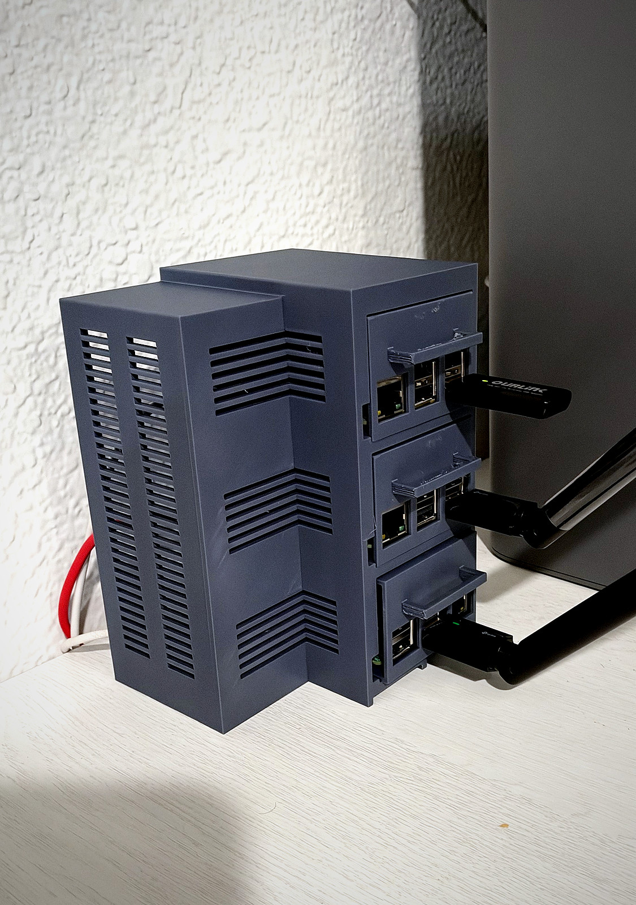
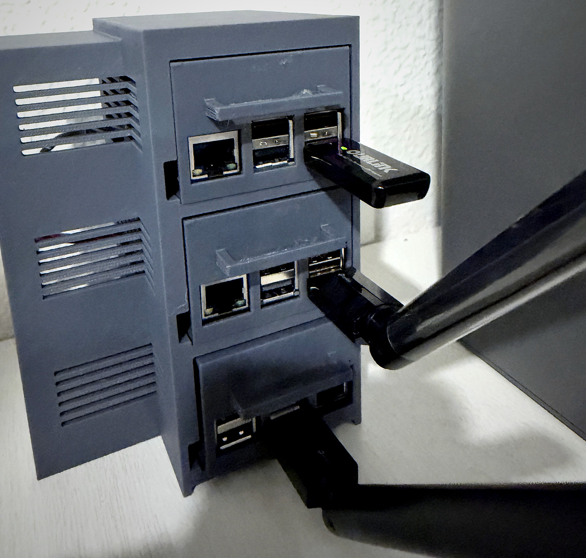
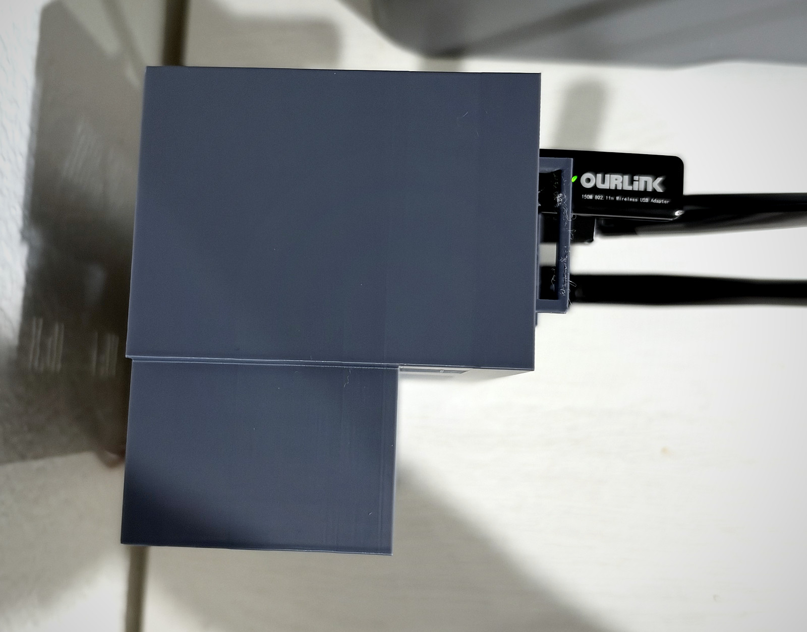

# pi-pair

Access and use the Platform: https://rpi-pi4.taild6c87d.ts.net/

Chat for a three-board Raspberry Pi rack. Stdlib Python on the boards, no pip. The page is served on 18080.

pi2, pi3, and pi4 all sit in one custom 3D-printed server rack. Tailscale names are rpi-pi2, rpi-pi3, and rpi-pi4.







## Boards

| Board | Role | Runs |
| --- | --- | --- |
| pi4 | brain | Flash `qwen3:0.6b` and Pro `qwen3:1.7b`. The only board that decodes. |
| pi3 | dataset | OCR, documents, charts, memory, compaction, Arctic xs embed. No decode. |
| pi2 | health | Web search and image cards. No decode. |

Search runs when the composer Search control is on. If it is off, the turn still searches when the line asks to search, look something up, use the web or tools, or google, or when it asks for the news in a short shape: latest news, news about, news on, latest on, in the news, what's the latest, or latest <word> news. A bare news, latest, current, or today, and every other line, is one local decode. The lookup stays on pi2.

## Layout

```
pi-pair/pair/core        config, errors, runtime, timing
pi-pair/pair/mesh        peers, health, offload, guard
pi-pair/pair/model       modes, knobs, chat, preload, sched
pi-pair/pair/turn        shape, assist, moderate, abilities
pi-pair/pair/memory      store, compact, ledger
pi-pair/pair/search      web lookup
pi-pair/pair/ingest      upload, OCR, documents
pi-pair/pair/render      charts, images, documents
pi-pair/pair/flywheel    canned map, queue, train cycle
pi-pair/pair/routes      HTTP route mixins
pi-pair/pair/nodes       worker, embedder, web search, memory store
pi-pair/pair/server.py   front server
pi-pair/web              page source; npm run build writes pi-pair/static
pi-pair/tests            unittest, mirrors pair/
pi-pair/scripts          operator commands (bench/, qa/, data/, eval/, lifecycle/, train/)
pi-pair/ops/downtime     pi4 nightly banner, 1:00-7:00 AM Pacific
pi-pair/docs             how the rack is built and run
docs/rack                photos of the rack
```

`peers.json` is gitignored. `install.sh` creates it from `peers.example.json` only when the board does not already have one.

## Install on a board

```bash
bash pi-pair/install.sh
```

Then run the `systemctl --user` lines it prints. The installer copies the whole `pair/` package, so a module that moved cannot linger on the board as a stale file.

## Nightly downtime

The public link on pi4 is Tailscale Funnel to `http://127.0.0.1:18080`. From 1:00 AM to 7:00 AM America/Los_Angeles that port is the downtime banner instead of `pi-pair.service`. `openpi-downtime.sh auto` turns the banner on when the Pacific hour is 1–6. The same command is idempotent. It does not change `mini_chat.py`.

The copies that run on the board are under `~/openpi-downtime/` and `~/.config/systemd/user/`. The tracked files are in `pi-pair/ops/downtime/`. Install on pi4 as user `pi`, from a checkout:

```bash
mkdir -p ~/openpi-downtime ~/.config/systemd/user
cp pi-pair/ops/downtime/openpi-downtime.sh pi-pair/ops/downtime/banner_server.py pi-pair/ops/downtime/banner.html ~/openpi-downtime/
cp pi-pair/ops/downtime/openpi-banner.service pi-pair/ops/downtime/openpi-downtime-apply.service pi-pair/ops/downtime/openpi-downtime-start.timer pi-pair/ops/downtime/openpi-downtime-end.timer ~/.config/systemd/user/
systemctl --user daemon-reload
systemctl --user enable --now openpi-downtime-start.timer openpi-downtime-end.timer openpi-downtime-apply.service
```

The start timer is 01:00 America/Los_Angeles and the end timer is 07:00. Both are persistent and both start `openpi-downtime-apply.service`, which runs `auto`. That unit also runs at boot.

Disable the window and bring chat back:

```bash
systemctl --user disable --now openpi-downtime-start.timer openpi-downtime-end.timer openpi-downtime-apply.service && ~/openpi-downtime/openpi-downtime.sh up
```

Chats held in memory are lost when `pi-pair` stops for the night. During the window, pi2 and pi3 cannot reach pi4 on port 18080.

## Develop

```bash
make check
git config core.hooksPath .githooks
```

`make check` runs ruff, the page typecheck, shellcheck, the Python tests, the page tests, and a rebuild check of `pi-pair/static`.

## Docs

- [Architecture](pi-pair/docs/ARCHITECTURE.md) — boards, mesh, the page, and what a miss does
- [API](pi-pair/docs/API.md) — endpoints, the keyed API, agents, environment
- [Operations](pi-pair/docs/OPERATIONS.md) — start, install, failures
- [Deploy](pi-pair/docs/DEPLOY.md) — CI and the pi3 sync
- [Train](pi-pair/docs/TRAIN.md) — train, then delete
- [Datasets](pi-pair/docs/DATASETS.md)
- [Embed](pi-pair/docs/EMBED.md)
- [Images](pi-pair/docs/IMAGES.md)
- [Sources](pi-pair/docs/SOURCES.md)
